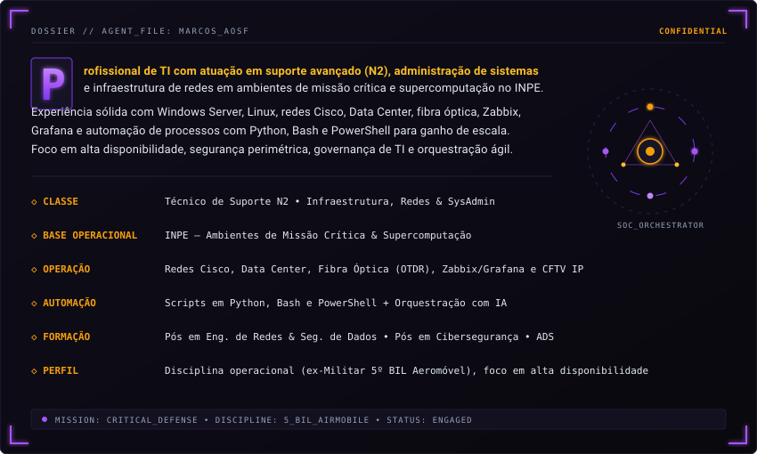

  <!-- HERO TACTICAL BANNER -->
  

  <!-- TERMINAL TYPEWRITER BAR -->
  

   

  <!-- QUICK ACTION BADGES (PRESERVADOS E ESTILIZADOS NA PALETA ROXO/AMBAR/CYBER) -->
  
  
  
  
  

 

<!-- SEÇÃO 01: SYS.INFO -->

  

<!-- SEÇÃO 02: ARSENAL -->

  

  

◆ **INFRAESTRUTURA &amp; REDES** 
<kbd>Cisco IOS</kbd> <kbd>Switches L2/L3</kbd> <kbd>Roteadores ISR</kbd> <kbd>VoIP / CME</kbd> <kbd>VLANs &amp; Trunking</kbd> <kbd>Spanning-Tree (STP)</kbd> <kbd>OSPF</kbd> <kbd>BGP</kbd> <kbd>TCP/IP</kbd> <kbd>Wireshark</kbd> <kbd>VPN / Radmin</kbd> <kbd>Wake-on-LAN</kbd> <kbd>Linux Sysadmin</kbd> <kbd>Windows Server</kbd>

  

◆ **CIBERSEGURANÇA &amp; HARDENING** 
<kbd>Hardening de Servidores</kbd> <kbd>IPTables / UFW</kbd> <kbd>CIS Benchmarks</kbd> <kbd>Nmap Vuln Scanning</kbd> <kbd>Análise de Tráfego L2</kbd> <kbd>CDP / LLDP Sniffing</kbd> <kbd>Segurança Perimétrica</kbd> <kbd>SOC Telemetry</kbd> <kbd>HackTheBox</kbd>

  

◆ **AUTOMAÇÃO &amp; IA ORCHESTRATION** 
<kbd>Python</kbd> <kbd>Netmiko</kbd> <kbd>Scapy</kbd> <kbd>Paramiko</kbd> <kbd>Jinja2 Templating</kbd> <kbd>Bash Scripting</kbd> <kbd>PowerShell CLI</kbd> <kbd>Multi-Agentes</kbd> <kbd>Gemini API</kbd> <kbd>GitHub Actions CI/CD</kbd>

  

◆ **DESENVOLVIMENTO &amp; FERRAMENTAS** 
<kbd>JavaScript (ES6+)</kbd> <kbd>TypeScript</kbd> <kbd>Three.js WebGL</kbd> <kbd>HTML5 / CSS3 Moderno</kbd> <kbd>REST APIs</kbd> <kbd>Git</kbd> <kbd>GitHub</kbd> <kbd>GitHub Pages</kbd> <kbd>Lua</kbd>

 

<!-- SEÇÃO 03: DEPLOYMENTS -->

  

| Operação / Repositório | Briefing Técnico | Stack &amp; Perfil |
| :--- | :--- | :--- |
| 📡 **[CDPR-SCAN](https://github.com/MarcosAosf/CDPR-SCAN)** | Mapeamento passivo de switches e topologia conectada à estação via pacotes CDP/LLDP com launcher interativo UAC. | `Python` `Scapy` `Rich` `Batch` `L2 Raw` |
| 🌐 **[NetOps-AutoPilot](https://github.com/MarcosAosf/netops-autopilot)** | Framework de automação multi-vendor (Cisco, Mikrotik) com rotinas de backup SHA256, diff e provisionamento Jinja2. | `Python` `Netmiko` `Scapy` `Jinja2` `Cisco` |
| 🖥️ **[Cisco Network Simulator](https://github.com/MarcosAosf/cisco-network-simulator)** | Dashboard interativo para treinamento em redes com simulador CLI Cisco IOS em tempo real. [👉 Live Demo](https://marcosaosf.github.io/cisco-network-simulator/) | `Cisco IOS` `React` `Tailwind` `CLI Engine` |
| 📊 **[NetPulse-3D](https://github.com/MarcosAosf/netpulse-3d)** | Cockpit 3D em tempo real para observabilidade de topologia de redes cloud e telemetria SOC. [👉 Live Demo](https://marcosaosf.github.io/netpulse-3d/) | `Three.js` `WebGL` `Canvas 60FPS` `SRE` |
| 🛡️ **[bash-hardening](https://github.com/MarcosAosf/bash-hardening)** | Ferramenta de blindagem e auditoria de infraestrutura Linux, controle de UFW/IPTables e análise de logs. | `Bash` `Hardening` `Firewall` `SysAdmin` |
| 🐝 **[ProjetoMeliponicultura](https://github.com/MarcosAosf/ProjetoMeliponicultura)** | Aplicação web interativa para preservação e catalogação de meliponíneos e sistemas ecológicos. | `JavaScript` `HTML5` `CSS3` `PowerShell` |
| 💻 **[cyberaosf](https://github.com/MarcosAosf/cyberaosf)** | Quartel-general digital: portfólio completo com terminal interativo, labs e certificações. [👉 Ver Portfólio](https://marcosaosf.github.io/cyberaosf/) | `HTML5` `Vanilla JS` `Matrix Canvas` `i18n` |

 

<strong>📜 Formação Acadêmica &amp; Credenciais Oficiais (Clique para expandir)</strong>

 

### 🎓 Formação Acadêmica
- **Pós-Graduação em Engenharia de Redes e Segurança de Dados** — Faculdade Líbano (2026).  
  *Foco: Alta disponibilidade, protocolos de roteamento, conectividade corporativa e governança.*
- **Pós-Graduação em Cibersegurança &amp; Segurança da Informação** — Faculdade Líbano (2026).  
  *Foco: Defesa em profundidade, resposta a incidentes, compliance e gestão de vulnerabilidades.*
- **Graduação em Análise e Desenvolvimento de Sistemas (ADS)** — Estácio (2023 – 2025).  
  *Foco: Algoritmos, banco de dados relacionais e modelagem de software.*
- **Curso Técnico em Tecnologia da Informação** — ETEC Centro Paula Souza (2018 – 2020).

---

### 🛡️ Certificações &amp; Extensões Relevantes
- **Cisco Cyber Threat Management** — Cisco Networking Academy / [Credly Badge](https://www.credly.com/badges/c41651a4-65f7-401b-b1db-a031ed5dd296)
- **Operação Curupira 3.0 (Guardião Cibernético 8.0)** — GoHacking (Defesa de Infraestrutura Crítica &amp; Pentest)
- **FIAP Cybersecurity** — FIAP (Governança, Perímetro e Segurança Defensiva)
- **Fibra Óptica Avançada &amp; OTDR Anritsu MT9085A** — INPE (Fusão com máquina Inno View 6S, DGO e testes ópticos)
- **Computação Científica com Python** — INPE (Análise de dados com NumPy, SciPy e Pandas)
- **Bootcamp Santander Cibersegurança &amp; Pentest** — DIO / Santander

 

<!-- SEÇÃO 04: TELEMETRY -->

  

<!-- SEÇÃO 05: ARCADE -->

<em>Cada commit, um disparo interceptado. Histórico de contribuições em modo Space Invaders / Galaga.</em>

  

  *(Gráfico dinâmico renderizado automaticamente via GitHub Actions com <code>czl9707/gh-space-shooter</code>)*

 

<!-- SEÇÃO 06: CONTATO -->

  

  
<em>Redes, suporte avançado, automação com Python ou projetos em cibersegurança:</em>

  

    📬 <b>E-mail:</b> <a href="mailto:marcosaosf2010@gmail.com"><code>marcosaosf2010@gmail.com</code></a> &nbsp;•&nbsp;
    🌐 <b>Portfólio:</b> <a href="https://marcosaosf.github.io/cyberaosf/"><code>cyberaosf</code></a> &nbsp;•&nbsp;
    💼 <b>LinkedIn:</b> <a href="https://linkedin.com"><code>Marcos Aosf</code></a>
  

  

    🎮 <b>Discord:</b> <code>SkyWalkher#7766</code> &nbsp;•&nbsp;
    🛡️ <b>HackTheBox:</b> <a href="https://app.hackthebox.com/profile/2930902"><code>Aosf [Enrolled]</code></a>
  

   

  <!-- FOOTER TACTICAL COMPONENT -->
  

 

⚙️ <strong>Arquitetura &amp; Automação deste Perfil (Clique para inspecionar)</strong>

 

Este perfil é executado sobre uma infraestrutura orientada a eventos e código vetorial (sem scripts client-side):
- **Motor Gráfico:** SVGs animados com CSS puro (`@keyframes`) e gradientes vetoriais em escala de 850px.
- **Telemetria (`update-stats.yml`):** Script em Python que consome a API GraphQL do GitHub com token de autorização, calcula níveis operacionais e gera o painel `assets/stats-hud.svg`.
- **Arcade Space Shooter (`update-arcade.yml`):** Action que transforma o histórico anual de commits em um arcade animado estilo Galaga (`assets/arcade.gif`).
- **Paleta de Alta Densidade:** Obsidian (`#09090D`), Cyber Purple (`#A855F7`), Glow (`#7C3AED`) e Telemetry Amber (`#F59E0B`).

