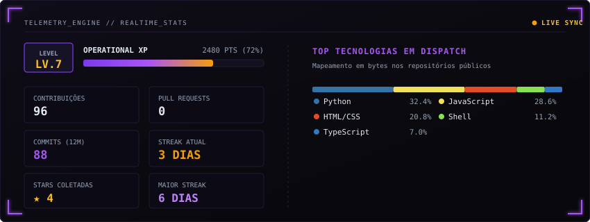
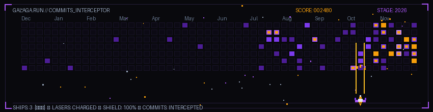

  <!-- HERO TACTICAL BANNER -->
  

  <!-- TERMINAL TYPEWRITER BAR -->
  

   

  <!-- QUICK ACTION BADGES (COM LINKS REAIS ATUALIZADOS) -->
  
  
  
  
  

 

<!-- SEÇÃO 01: SYS.INFO -->

  

<!-- SEÇÃO 02: ARSENAL -->

  

  

◆ **INFRAESTRUTURA &amp; REDES** 
<kbd>Cisco Switching &amp; Routing</kbd> <kbd>TCP/IP</kbd> <kbd>DNS</kbd> <kbd>DHCP</kbd> <kbd>VLAN &amp; Trunking</kbd> <kbd>Spanning-Tree (STP)</kbd> <kbd>Cabeamento Estruturado</kbd> <kbd>Fibra Óptica</kbd> <kbd>OTDR Anritsu MT9085A</kbd> <kbd>CFTV IP (Hikvision / VMS)</kbd> <kbd>Telefonia IP</kbd> <kbd>Wireshark</kbd>

  

◆ **SISTEMAS &amp; DATA CENTER** 
<kbd>Windows Server</kbd> <kbd>Active Directory</kbd> <kbd>Linux (Ubuntu, Fedora, Mint)</kbd> <kbd>Windows 10/11</kbd> <kbd>macOS</kbd> <kbd>Servidores &amp; Racks</kbd> <kbd>Ambientes de Missão Crítica</kbd> <kbd>Supercomputação (INPE)</kbd>

  

◆ **OBSERVABILIDADE &amp; CIBERSEGURANÇA** 
<kbd>Zabbix</kbd> <kbd>Grafana</kbd> <kbd>Hardening de Servidores</kbd> <kbd>Análise de Logs</kbd> <kbd>Network Scanning (Nmap)</kbd> <kbd>Cyber Threat Management (Cisco)</kbd> <kbd>Segurança de Dados</kbd> <kbd>SOC Telemetry</kbd> <kbd>HackTheBox</kbd>

  

◆ **AUTOMAÇÃO &amp; DESENVOLVIMENTO** 
<kbd>Python (Netmiko, Scapy, NumPy, Pandas)</kbd> <kbd>Bash Scripting</kbd> <kbd>PowerShell</kbd> <kbd>JavaScript (ES6+)</kbd> <kbd>Three.js WebGL</kbd> <kbd>IA Generativa &amp; Multi-Agentes</kbd> <kbd>Git</kbd> <kbd>GitHub Actions CI/CD</kbd>

 

<!-- SEÇÃO 03: DEPLOYMENTS -->

  

| Operação / Repositório | Briefing Técnico | Stack &amp; Perfil |
| :--- | :--- | :--- |
| 📹 **Infraestrutura CFTV IP &amp; Fibra — Campus INPE** | Implantação de videomonitoramento IP corporativo em campus de ~11,6M m²: câmeras Hikvision, enlaces ópticos, racks, parametrização de VMS, rotinas de auditoria e 99.9% uptime. | `CFTV IP` `Hikvision` `Fibra Óptica` `VMS` `Racks` |
| 📡 **[CDPR-SCAN](https://github.com/MarcosAosf/CDPR-SCAN)** | Mapeamento passivo de switches e topologia conectada à estação via pacotes CDP/LLDP com launcher interativo UAC para Windows e Linux. | `Python` `Scapy` `Rich` `Batch` `L2 Raw` |
| 🌐 **[NetOps-AutoPilot](https://github.com/MarcosAosf/netops-autopilot)** | Framework de automação de redes multi-vendor (Cisco, Mikrotik) com rotinas de backup automatizado SHA256, diff e provisionamento Jinja2. | `Python` `Netmiko` `Scapy` `Jinja2` `Cisco` |
| 🖥️ **[Cisco Network Simulator](https://github.com/MarcosAosf/cisco-network-simulator)** | Dashboard interativo para treinamento em redes com simulador CLI Cisco IOS em tempo real. [👉 Live Demo](https://marcosaosf.github.io/cisco-network-simulator/) | `Cisco IOS` `React` `Tailwind` `CLI Engine` |
| 📊 **[NetPulse-3D](https://github.com/MarcosAosf/netpulse-3d)** | Cockpit 3D em tempo real para observabilidade de topologia de redes cloud e telemetria SOC. [👉 Live Demo](https://marcosaosf.github.io/netpulse-3d/) | `Three.js` `WebGL` `Canvas 60FPS` `SRE` |
| 🛡️ **[bash-hardening](https://github.com/MarcosAosf/bash-hardening)** | Ferramenta de blindagem e auditoria de infraestrutura Linux, gestão de UFW/IPTables e análise de logs contra anomalias. | `Bash` `Hardening` `Firewall` `SysAdmin` |
| 🐝 **[ProjetoMeliponicultura](https://github.com/MarcosAosf/ProjetoMeliponicultura)** | Aplicação web interativa para preservação e catalogação de meliponíneos e sistemas ecológicos. | `JavaScript` `HTML5` `CSS3` `PowerShell` |
| 💻 **[cyberaosf](https://github.com/MarcosAosf/cyberaosf)** | Quartel-general digital: portfólio completo com terminal interativo, labs e certificações. [👉 Ver Portfólio](https://marcosaosf.github.io/cyberaosf/) | `HTML5` `Vanilla JS` `Matrix Canvas` `i18n` |

 

<!-- SEÇÃO 04: FORMAÇÃO & CREDENCIAIS -->

### 🎓 Formação Acadêmica
- 🎓 **Pós-graduação em Engenharia de Redes e Segurança de Dados** — Faculdade Líbano *(Concluída em out/2026)*  
  *Foco: Alta disponibilidade, protocolos de roteamento corporativo, governança e proteção de dados em trânsito.*
- 🎓 **Pós-graduação em Cibersegurança** — Faculdade Líbano *(Concluída em ago/2026)*  
  *Foco: Defesa em profundidade, resposta a incidentes, mitigação de ameaças, conformidade e gestão de vulnerabilidades.*
- 🎓 **Tecnólogo em Análise e Desenvolvimento de Sistemas (ADS)** — Faculdade Estácio *(Concluído em jul/2025)*  
  *Foco: Engenharia de software, algoritmos escaláveis, bancos de dados relacionais e modelagem de sistemas.*
- 🎓 **Técnico em Informática** — ETEC Prof. Marcos Uchôas dos Santos Penchel *(Concluído em dez/2020)*  
  *Foco: Arquitetura de computadores, redes locais (LAN), infraestrutura e lógica de programação.*

 

<strong>▸ 💼 Experiência Profissional (Clique para expandir)</strong>

 

- **Técnico de Suporte N2 — Instituto Nacional de Pesquisas Espaciais (INPE)** *(Abr/2024 – Atual)*  
  - Suporte técnico N2 a ambientes corporativos, estações de pesquisa e Data Center de Supercomputação.
  - Administração de estações e servidores Windows, Windows Server, Linux (Ubuntu, Fedora, Mint) e macOS.
  - Automação de processos operacionais e auditorias periódicas com scripts em Python, Bash e PowerShell.
  - Monitoramento proativo de ativos de TI e links de rede com Zabbix e Grafana.
  - Manutenção de redes corporativas em switches e roteadores Cisco, cabeamento estruturado e conectorização de fibra óptica.
  - Operação de máquina de fusão óptica e certificação de enlaces com OTDR Anritsu MT9085A.
  - Implantação e gestão de infraestrutura de CFTV IP corporativo Hikvision e parametrização de VMS.

- **Militar Socorrista — 5º Batalhão de Infantaria Aeromóvel (Exército Brasileiro)** *(2022 – 2023)*  
  - Atuação em missões aeromóveis e operacionais de alta pressão, exigindo tomada de decisão rápida e disciplina tática.
  - Liderança de equipes, gestão de riscos operacionais e execução rigorosa de protocolos de segurança.

- **Estagiário de TI — Instituto Nacional de Pesquisas Espaciais (INPE)** *(Jan/2021 – Dez/2022)*  
  - Suporte ao usuário em hardware e software (Windows e Linux).
  - Gestão de acessos, permissões e contas corporativas.
  - Apoio na manutenção de infraestrutura de redes locais, telefonia IP e suporte a sistemas de CFTV.

 

<strong>▸ 📜 Certificações e Credenciais de Destaque (Clique para expandir)</strong>

 

- 🛡️ **Cybersecurity** — FIAP *(2026)*: Fundamentos aplicados de segurança ofensiva e defensiva, controle de perímetros e governança.
- 🌐 **Cyber Threat Management** — Cisco Networking Academy *(2025)*: Identificação, contenção e resposta a ameaças perimétricas ([Credly Badge](https://www.credly.com/badges/c41651a4-65f7-401b-b1db-a031ed5dd296)).
- 🐍 **Computação Científica com Python** — INPE *(2025)*: Análise de dados científicos com NumPy, Matplotlib, SciPy e Pandas.
- 🎯 **Bootcamp de Cibersegurança &amp; Pentest** — Santander / DIO *(2025)*: Varredura de redes, exploração de vulnerabilidades e Kali Linux.
- 📡 **Conceitos, Técnicas, Fundamentos de Redes e Varredura** — DIO *(2025)*.
- ⚡ **Agile Scrum Foundation** — EXIN / Grupo Voitto *(2024)*: Metodologias ágeis de gestão e ritos Scrum.
- 🔬 **Curso Avançado OTDR Anritsu MT9085A, Fusão Óptica e Lançamento** — INPE *(2023)*: Testes ópticos de atenuação e montagem de DGO.

 

<!-- SEÇÃO 05: TELEMETRY -->

  

<!-- SEÇÃO 06: ARCADE -->

<em>Cada contribuição, um inimigo a menos. Meu histórico real de commits em modo Galaga.</em>

  

  *(Gráfico interativo em pixel art gerado dinamicamente com commits reais das 52 semanas)*

 

<!-- SEÇÃO 07: CONTATO -->

  

  
<em>Ambientes de missão crítica, redes Cisco, automação com Python ou cibersegurança:</em>

  

    📬 <b>E-mail:</b> <a href="mailto:marcosaosf2010@gmail.com"><code>marcosaosf2010@gmail.com</code></a> &nbsp;•&nbsp;
    🌐 <b>Portfólio:</b> <a href="https://marcosaosf.github.io/cyberaosf/"><code>cyberaosf</code></a> &nbsp;•&nbsp;
    💼 <b>LinkedIn:</b> <a href="https://www.linkedin.com/in/marcos-a-a24862262/"><code>marcos-a-a24862262</code></a>
  

  

    🎮 <b>Discord:</b> <code>SkyWalkher#7766</code> &nbsp;•&nbsp;
    🛡️ <b>HackTheBox:</b> <a href="https://app.hackthebox.com/profile/2930902"><code>Aosf [Enrolled]</code></a>
  

   

  <!-- FOOTER TACTICAL COMPONENT -->
  

 

⚙️ <strong>Arquitetura &amp; Automação deste Perfil (Clique para inspecionar)</strong>

 

Este perfil é executado sobre uma infraestrutura orientada a eventos e código vetorial (sem scripts client-side):
- **Motor Gráfico:** SVGs animados com CSS puro (`@keyframes`) e gradientes vetoriais em escala de 850px.
- **Arcade Galaga Nativo:** Script em Python (`scripts/generate_arcade.py`) com Pillow que processa a matriz 52x7 de commits reais do GitHub e renderiza um loop retrô com nave espacial e disparos laser âmbar.
- **Telemetria de Sistema:** Script em Python (`scripts/generate_stats.py`) que consome a API GraphQL do GitHub com token de autorização, calcula níveis operacionais e gera o painel `assets/stats-hud.svg`.
- **Paleta de Alta Densidade:** Obsidian (`#09090D`), Cyber Purple (`#A855F7`), Glow (`#7C3AED`) e Telemetry Amber (`#F59E0B`).

