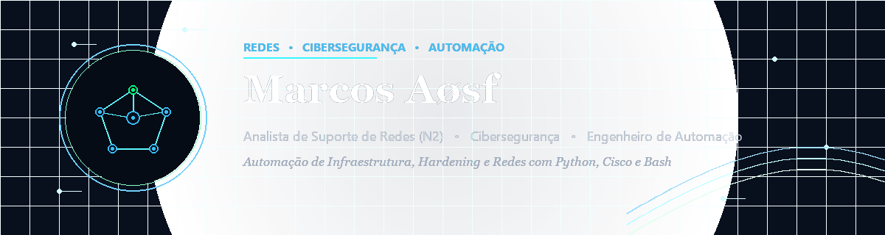

<div align="center">

  <!-- Banner Principal -->
  

  <br><br>

  <!-- Badges de Contato e Identidade -->
  <a href="https://marcosaosf.github.io/cyberaosf/">
    
  </a>
  <a href="mailto:marcosaosf2010@gmail.com">
    
  </a>
  <a href="https://discord.gg/SkyWalkher#7766">
    
  </a>
  <a href="https://app.hackthebox.com/profile/2930902">
    
  </a>

</div>

<br>

### 👨‍💻 Sobre Mim // `whoami`

```bash
root@marcos:~# whoami
Marcos Aosf — Analista de Suporte de Redes (N2) & Estudante de Cibersegurança
```

Atuo na sustentação de infraestrutura de conectividade corporativa, resolução de incidentes críticos de camada 2 e camada 3, roteamento estático/dinâmico e automação de rotinas operacionais com scripts em Python e Bash.

* 🌐 **Redes & Infraestrutura:** Roteadores e Switches Cisco (Catalyst, ISR), Mikrotik RouterOS, VLANs, Spanning-Tree, OSPF, BGP e análise de tráfego com Wireshark.
* ⚡ **Automação de Redes (NetDevOps):** Desenvolvimento de scripts com Netmiko, Scapy, Paramiko e templates Jinja2 para backup automatizado e auditoria de configurações.
* 🛡️ **Segurança & Hardening:** Blindagem de servidores Linux, auditoria de regras de firewall (IPTables/UFW), análise de vulnerabilidades com Nmap e práticas de conformidade CIS.

---

### 🚀 Projetos em Destaque

| Projeto | Descrição | Tecnologias |
| :--- | :--- | :--- |
| 🌐 **[NetOps-AutoPilot](https://github.com/MarcosAosf/netops-autopilot)** | Framework de automação de redes multi-vendor (Cisco, Mikrotik) com backup SHA256, diff e provisionamento Jinja2. | `Python` `Netmiko` `Scapy` `Jinja2` |
| 🖥️ **[Cisco Network Simulator](https://github.com/MarcosAosf/cisco-network-simulator)** | Dashboard interativo de treinamento com simulador CLI Cisco IOS em tempo real. [👉 Live Demo](https://marcosaosf.github.io/cisco-network-simulator/) | `Cisco IOS` `React` `Tailwind` |
| 📊 **[NetPulse-3D](https://github.com/MarcosAosf/netpulse-3d)** | Cockpit 3D em WebGL para visualização de topologias de rede cloud e telemetria SOC. [👉 Live Demo](https://marcosaosf.github.io/netpulse-3d/) | `Three.js` `WebGL` `OpenTelemetry` |
| 🔍 **[ZTerm VulnScanner](https://github.com/MarcosAosf/zterm-scanner)** | Wrapper automatizado de scan de portas com Nmap e correlação de CVEs em Markdown. | `Python` `Nmap` `API` |
| 🛡️ **[Hardening & Governance](https://github.com/MarcosAosf/bash-hardening)** | Ferramenta de blindagem e auditoria de segurança para servidores Linux e firewalls. | `Bash` `Hardening` `Firewall` |
| 📡 **[CDPR-SCAN](https://github.com/MarcosAosf/CDPR-SCAN)** | Mapeamento passivo de topologia de switches conectados à estação de trabalho via pacotes CDP/LLDP. | `Bash` `PowerShell` `Network` |

---

### 🛠️ Tecnologias & Ferramentas

<div align="center">
  
  
  
  
  
  
  
  
</div>

<br>

---

### 📊 Estatísticas do GitHub & Conquistas

<table border="0" width="100%">
  <tr align="center" style="background-color: transparent; border: none;">
    <td style="border: none;">
      
    </td>
    <td style="border: none;">
      
    </td>
  </tr>
  <tr align="center" style="background-color: transparent; border: none;">
    <td style="border: none;">
      <a href="https://app.hackthebox.com/profile/2930902">
        
      </a>
    </td>
    <td style="border: none;">
      
    </td>
  </tr>
</table>

<br>

<div align="center">
  
</div>

<br>

<div align="center">
  <sub>Construído com dedicação por <b>Marcos Aosf</b> // Focado em Redes, Segurança e Automação</sub>
</div>
